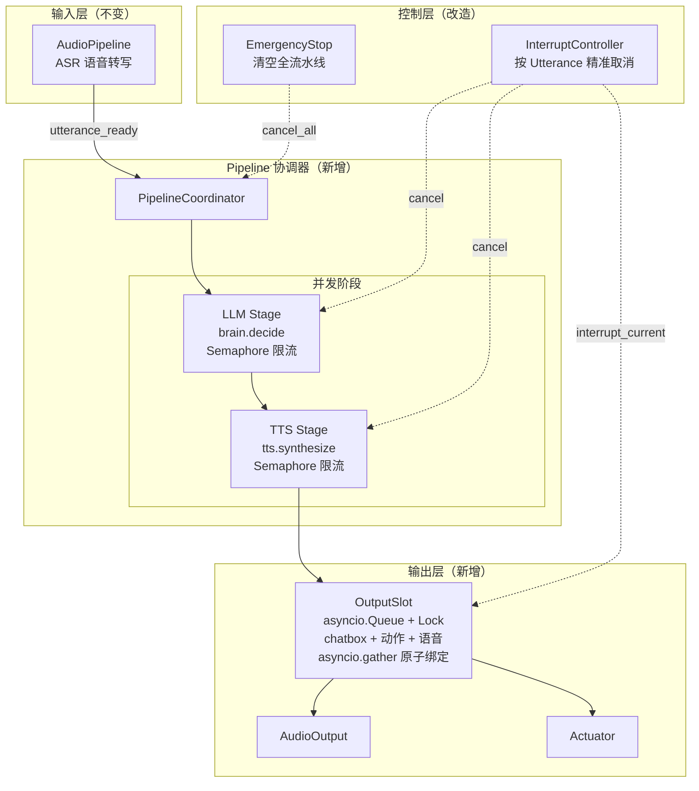
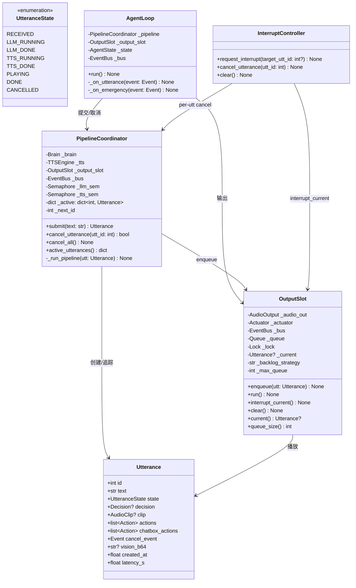
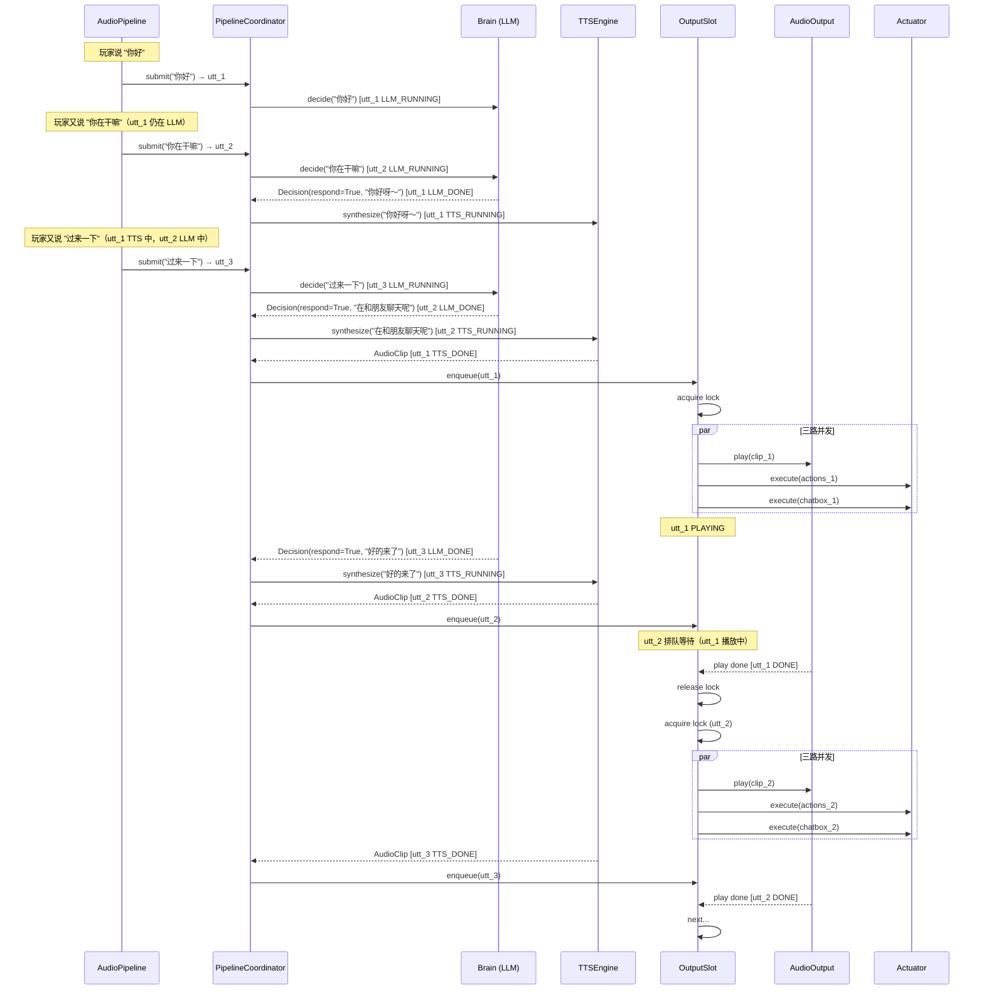
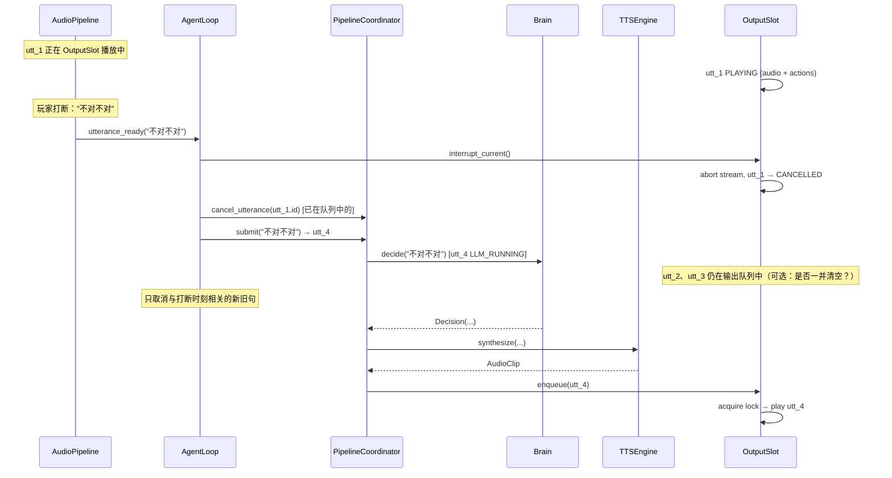
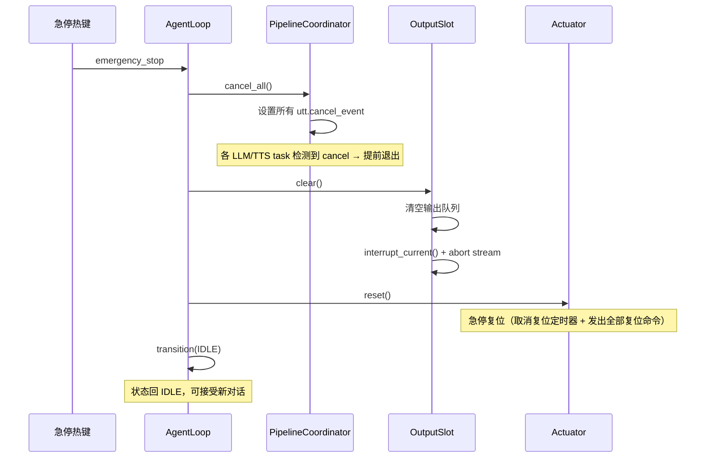
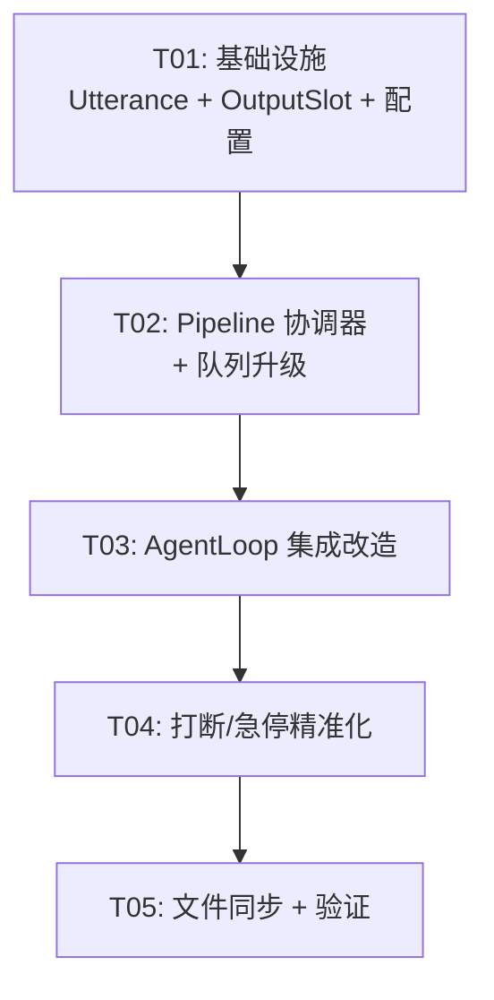

# VRChat Agent 处理管道并发化改造 — 系统架构设计

> **作者**：高见远（Gao）· 架构师  
> **日期**：2026-08-03  
> **上游输入**：许清楚（Xu）· 产品经理的 PRD「处理管道并发化改造」

---

## 目录

1. [实现方案 + 框架选型](#1-实现方案--框架选型)
2. [文件列表](#2-文件列表)
3. [数据结构和接口](#3-数据结构和接口)
4. [程序调用流程](#4-程序调用流程)
5. [任务列表](#5-任务列表)
6. [依赖包列表](#6-依赖包列表)
7. [待回答/待确认的设计决策](#7-待回答待确认的设计决策)
8. [文件同步实现方案](#8-文件同步实现方案)

---

## 1. 实现方案 + 框架选型

### 1.1 整体架构

将当前 `_processing_lock` 覆盖的「大串行管道」拆分为 **三段独立流水线 + 一个互斥输出槽**：

```
                  ┌──────────┐    ┌──────────┐    ┌──────────┐    ┌────────────┐
 utterance_ready  │  LLM     │    │  TTS     │    │ Output   │    │  VRChat    │
 ───────────────► │  Stage   │───►│  Stage   │───►│  Slot    │───►│  输出      │
                  │ (并发)   │    │ (并发)   │    │ (互斥)   │    │            │
                  └──────────┘    └──────────┘    └──────────┘    └────────────┘
                       │               │               │
                  Utterance A     Utterance A     Utterance A (播放中)
                  Utterance B     Utterance B     Utterance B (排队等待)
                  (LLM 中)       (TTS 中)        Utterance C (排队等待)
```

**核心变化**：

| 维度 | 旧（串行大锁） | 新（流水线并发） |
|------|---------------|-----------------|
| 锁范围 | `_processing_lock` 覆盖全管道 | 无全局锁；OutputSlot 用 `asyncio.Lock` 仅锁输出 |
| 管道语义 | 一次只处理一条，后续排队 | 多条可同时在 LLM/TTS 阶段，只有输出串行 |
| 取消粒度 | 全局 `_interrupt` 标志 | 每条 Utterance 有独立 `cancel_event` |
| UtteranceQueue | 入口文本 FIFO | 升级为持有 Utterance 对象 + 输出槽队列 |
| 状态机 | 全局单状态 | 全局状态 + 每条 Utterance 独立状态 |

### 1.2 架构组件图



### 1.3 选型理由

| 方案 | 评估 | 结论 |
|------|------|------|
| **asyncio 原生协程 + Task** | 已有代码全栈 asyncio；无需引入新框架 | ✅ 采用 |
| **asyncio.Semaphore** 限流 | 控制 LLM/TTS 并发上限，避免 API 侧 429 | ✅ 采用 |
| **asyncio.Queue** 输出槽 | 天然 FIFO，支持 `get_nowait` 清空、`put` 入队 | ✅ 采用 |
| **asyncio.Event** 单句取消 | 轻量，每条 Utterance 一个，无需全局状态 | ✅ 采用 |
| **引入 celery/rabbitmq** | 过度设计；单进程内协程并发已足够 | ❌ 不采用 |
| **多进程并行** | ASR 模型（faster-whisper）已占 GPU，多进程会竞争 CUDA | ❌ 不采用 |
| **ThreadPoolExecutor** | GIL + sounddevice 回调线程已存在，引入反而复杂 | ❌ 不采用 |

### 1.4 关键模块职责与接口契约

#### 1.4.1 Utterance（数据载体）

```python
from dataclasses import dataclass, field
from enum import Enum, auto
import asyncio
from ..brain.schema import Decision, Action
from ..speech.tts import AudioClip

class UtteranceState(Enum):
    RECEIVED = auto()      # 已收到文本
    LLM_RUNNING = auto()   # LLM 决策中
    LLM_DONE = auto()      # 决策完成
    TTS_RUNNING = auto()   # TTS 合成中
    TTS_DONE = auto()      # 合成完成，等待输出槽
    PLAYING = auto()       # 输出槽播放中
    DONE = auto()          # 正常完成
    CANCELLED = auto()     # 被打断/急停取消

@dataclass
class Utterance:
    id: int                          # 单调递增 ID
    text: str                        # 原始转写文本
    state: UtteranceState = UtteranceState.RECEIVED
    decision: Decision | None = None
    clip: AudioClip | None = None
    actions: list[Action] = field(default_factory=list)
    chatbox_actions: list[Action] = field(default_factory=list)
    cancel_event: asyncio.Event = field(default_factory=asyncio.Event)
    vision_b64: str | None = None    # 可选视觉画面
    created_at: float = field(default_factory=time.time)
    latency_s: float = 0.0
```

#### 1.4.2 OutputSlot（互斥输出槽）

```python
class OutputSlot:
    """互斥输出槽：asyncio.Queue + Lock，chatbox＋动作＋语音原子绑定。"""
    
    def __init__(
        self,
        audio_out: AudioOutput,
        actuator: Actuator,
        bus: EventBus,
        backlog_strategy: str = "drop_oldest",  # "drop_oldest" | "drop_newest"
        max_queue: int = 3,
    ) -> None: ...
    
    async def enqueue(self, utt: Utterance) -> None:
        """将已完成 TTS 的 utterance 入队。根据 backlog_strategy 处理积压。"""
    
    async def run(self) -> None:
        """主循环：从队列取 utterance，获取锁，播放+动作并发执行。"""
    
    async def interrupt_current(self) -> None:
        """打断当前播放（不阻塞）：置 stop_flag + abort stream。"""
    
    def clear(self) -> None:
        """清空输出队列（急停：丢弃所有未播放的内容）。"""
    
    @property
    def current(self) -> Utterance | None:
        """当前正在播放的 utterance（供仪表盘/打断使用）。"""
    
    @property
    def queue_size(self) -> int:
        """输出槽待播放数量。"""
```

#### 1.4.3 PipelineCoordinator（流水线协调器）

```python
class PipelineCoordinator:
    """三段流水线协调器。"""
    
    def __init__(
        self,
        brain: Brain,
        tts: TTSEngine,
        output_slot: OutputSlot,
        bus: EventBus,
        vision: VisionSensor | None = None,
        sampler: ImageSampler | None = None,
        config=None,
        llm_semaphore: asyncio.Semaphore | None = None,
        tts_semaphore: asyncio.Semaphore | None = None,
    ) -> None: ...
    
    async def submit(self, text: str) -> Utterance:
        """提交一条 utterance 进入流水线，立即返回 Utterance 对象。"""
    
    async def cancel_utterance(self, utt_id: int) -> bool:
        """取消指定 utterance（设置 cancel_event）。"""
    
    async def cancel_all(self) -> None:
        """取消所有在途 utterance（急停）。"""
    
    @property
    def active_utterances(self) -> dict[int, Utterance]:
        """当前在流水线中的所有 utterance（供仪表盘）。"""
```

---

## 2. 文件列表

| 路径 | 状态 | 变更说明 |
|------|------|----------|
| `src/vrchat_agent/core/utterance.py` | **新增** | Utterance 数据类 + UtteranceState 枚举 |
| `src/vrchat_agent/core/output_slot.py` | **新增** | OutputSlot 互斥输出槽 |
| `src/vrchat_agent/core/pipeline.py` | **新增** | PipelineCoordinator 三段流水线协调器 |
| `src/vrchat_agent/core/agent_loop.py` | **修改** | 集成 PipelineCoordinator；移除 `_processing_lock`；改造事件处理器 |
| `src/vrchat_agent/core/utterance_queue.py` | **修改** | 语义升级：从文本 FIFO 变为 Utterance 对象队列；保留批量合并能力 |
| `src/vrchat_agent/core/interrupt.py` | **修改** | 增加 per-utterance cancel 支持（保留全局标志兼容旧路径） |
| `src/vrchat_agent/events.py` | **修改** | 新增事件类型：`pipeline_stage_changed`、`output_slot_changed` |
| `config.yaml` | **修改** | 新增 `agent.pipeline` 配置段（LLM/TTS 并发度、输出槽策略） |
| `src/vrchat_agent/main.py` | **修改** | 装配 PipelineCoordinator + OutputSlot；传入 AgentLoop |
| `scripts/sync_release.py` | **新增** | 发布目录同步脚本 |
| `tests/test_pipeline.py` | **新增** | 流水线集成测试 |
| `src/vrchat_agent/brain/brain.py` | **无需改** | — |
| `src/vrchat_agent/brain/llm_client.py` | **无需改** | 已支持 `asyncio.wait_for`，天然可并发调用 |
| `src/vrchat_agent/speech/tts.py` | **无需改** | — |
| `src/vrchat_agent/speech/tts_mimo.py` | **无需改** | — |
| `src/vrchat_agent/speech/audio_output.py` | **无需改** | play/stop 接口满足 OutputSlot 需求 |
| `src/vrchat_agent/action/mcp_actuator.py` | **无需改** | execute/reset/shutdown 接口满足需求 |

---

## 3. 数据结构和接口

### 3.1 类图



### 3.2 config.yaml 新增配置段

```yaml
agent:
  pipeline:
    # LLM 阶段最大并发请求数（MiMo API 限流可配）
    llm_max_concurrency: 2
    # TTS 阶段最大并发请求数
    tts_max_concurrency: 2
    # 输出槽积压策略: drop_oldest（丢最旧，适合对话）| drop_newest（丢最新）
    output_backlog: drop_oldest
    # 输出槽最大排队深度
    output_max_queue: 3
```

---

## 4. 程序调用流程

### 4.1 正常流程：3 条连续对话在流水线中流转



### 4.2 打断流程：播放中途打断、旧句取消、新句直接上槽



**打断策略细化**：
- 打断时：立刻 `interrupt_current()`（停止当前播放）
- 同时：取消**当前播放**的 utt 和**同批次队列中已过时**的 utt
- 新句直接走流水线，不等待旧句的 LLM/TTS 完成
- 已在 LLM/TTS 阶段的旧句：设置 `cancel_event`，阶段完成后检测到 cancel → 不投输出槽

### 4.3 急停流程：清空全流水线



---

## 5. 任务列表

### 5.1 任务总览

| ID | 标题 | 优先级 | 依赖 | 涉及文件数 |
|----|------|--------|------|-----------|
| T01 | 基础设施：Utterance 数据模型 + OutputSlot + 配置 | P0 | — | 4 |
| T02 | Pipeline 协调器 + 队列升级 | P0 | T01 | 3 |
| T03 | AgentLoop 集成改造 | P0 | T02 | 3 |
| T04 | 打断/急停精准化 | P1 | T03 | 3 |
| T05 | 文件同步脚本 + 验证 | P2 | T04 | 3 |

### 5.2 任务详情

#### T01: 基础设施：Utterance 数据模型 + OutputSlot + 配置

- **涉及文件**：
  - `src/vrchat_agent/core/utterance.py`（新增）
  - `src/vrchat_agent/core/output_slot.py`（新增）
  - `config.yaml`（修改）
  - `src/vrchat_agent/events.py`（修改）
- **依赖**：无
- **产出描述**：
  1. `Utterance` dataclass + `UtteranceState` 枚举（8 个状态）
  2. `OutputSlot` 类：`enqueue`/`run`/`interrupt_current`/`clear`/属性
  3. `config.yaml` 新增 `agent.pipeline` 段（4 个配置项）
  4. `events.py` 新增 `PIPELINE_STAGE_CHANGED`、`OUTPUT_SLOT_CHANGED` 事件类型
- **验收标准**：
  - `Utterance` 可通过 `cancel_event` 被外部取消
  - `OutputSlot.enqueue` 支持 `drop_oldest`/`drop_newest` 两种积压策略
  - `OutputSlot.run` 用 `asyncio.gather` 原子绑定 chatbox + 动作 + 语音
  - 配置可热重载（从 `self._config` 读取，异常回退默认值）

#### T02: Pipeline 协调器 + 队列升级

- **涉及文件**：
  - `src/vrchat_agent/core/pipeline.py`（新增）
  - `src/vrchat_agent/core/utterance_queue.py`（修改）
  - `src/vrchat_agent/core/interrupt.py`（修改）
- **依赖**：T01
- **产出描述**：
  1. `PipelineCoordinator` 类：`submit`/`cancel_utterance`/`cancel_all`/`active_utterances`
  2. 内部 `_run_pipeline(utt)` 协程：LLM → TTS → OutputSlot，每阶段前检测 `cancel_event`
  3. `asyncio.Semaphore` 控制 LLM/TTS 并发上限
  4. `UtteranceQueue` 升级：从 `list[str]` 变为持有 `Utterance` 对象；保留 `pop_batch` 合并语义
  5. `InterruptController` 增加 `cancel_utterance(utt_id)` + `cancel_all()` 方法
- **验收标准**：
  - 3 条连续对话可同时在 LLM/TTS 不同阶段（日志验证）
  - `cancel_utterance` 后对应 utt 的 `cancel_event` 被设置
  - 阶段内检测到 cancel 后不投输出槽
  - semaphore 限流生效（超并发时等待而非崩溃）

#### T03: AgentLoop 集成改造

- **涉及文件**：
  - `src/vrchat_agent/core/agent_loop.py`（修改）
  - `src/vrchat_agent/main.py`（修改）
  - `config.yaml`（修改——配合 T01 已完成，此任务可能微调）
- **依赖**：T02
- **产出描述**：
  1. `AgentLoop.__init__` 接收 `PipelineCoordinator` + `OutputSlot`（替代直接持有 `_processing_lock`）
  2. 移除 `_processing_lock`、`_handle_utterance` 大方法重构为委托 `PipelineCoordinator.submit`
  3. `_on_utterance` 简化：直接 `pipeline.submit(text)`，打断路径走 `output_slot.interrupt_current() + pipeline.cancel_utterance()`
  4. `main.py` 装配 PipelineCoordinator + OutputSlot，传入 AgentLoop
  5. `_on_emergency` 改为调用 `pipeline.cancel_all() + output_slot.clear()`
  6. 状态机简化：全局状态仅保留 IDLE/SPEAKING/EMERGENCY_STOP（LISTENING/THINKING 由 utterance 状态承载）
- **验收标准**：
  - 移除 `_processing_lock` 后无死锁
  - 原有端到端延迟预算 < 8s 不劣化（最好更优：TTS 与下一句 LLM 重叠）
  - 状态机合法流转表更新、事件发布保持
  - Web 仪表盘 `control_status()` 数据完整

#### T04: 打断/急停精准化

- **涉及文件**：
  - `src/vrchat_agent/core/agent_loop.py`（修改）
  - `src/vrchat_agent/core/pipeline.py`（修改）
  - `src/vrchat_agent/core/output_slot.py`（修改）
- **依赖**：T03
- **产出描述**：
  1. 打断路径细化：
     - 说话中打断 → `output_slot.interrupt_current()` + 取消当前 utt + 清空输出队列中同批次旧句
     - 新句立即 `pipeline.submit()`，不等待旧 pipeline 任务
  2. 急停路径：`pipeline.cancel_all()`（设置所有 cancel_event）+ `output_slot.clear()` + `actuator.reset()`
  3. 边界情况处理：
     - 打断期间又来新打断（连续快速说话）
     - 急停后立即恢复对话
     - LLM/TTS 超时的 utterance 标记为 CANCELLED 而非卡在 active 表
  4. 仪表盘观测：`active_utterances` 实时反映流水线状态
- **验收标准**：
  - 播放中途打断 < 200ms 停止语音（现有 < 50ms 不劣化）
  - 急停后所有在途 LLM/TTS task 在 1s 内退出
  - 急停后 utterance 残留数 = 0（active_utterances 为空）
  - 连续 5 次快速打断不产生僵尸 task

#### T05: 文件同步脚本 + 验证

- **涉及文件**：
  - `scripts/sync_release.py`（新增）
  - `scripts/sync_release.bat`（新增）
  - `tests/test_pipeline.py`（新增）
- **依赖**：T04
- **产出描述**：
  1. `sync_release.py`：轻量同步脚本（见第 8 节设计）
  2. `sync_release.bat`：Windows 一键同步批处理
  3. `test_pipeline.py`：集成测试
     - 正常 3 句并发流转
     - 打断取消当前句
     - 急停清空全流水线
     - 输出槽积压策略
     - LLM/TTS semaphore 限流
  4. 在 `config.yaml` 注释中补充 `pipeline` 段说明
- **验收标准**：
  - `sync_release.py --dry-run` 正确列出差异
  - `sync_release.py` 同步后发布目录结构与源一致
  - 集成测试全部通过（`pytest tests/test_pipeline.py -v`）

### 5.3 任务依赖图



---

## 6. 依赖包列表

**无需新增任何 Python/Node 依赖**。本改造全部基于 Python 标准库 `asyncio` + 现有依赖：

| 现有依赖 | 用途 |
|----------|------|
| `asyncio`（标准库） | Task/Semaphore/Queue/Lock/Event——所有并发原语 |
| `openai` | LLMClient / MimoTTSEngine 的 AsyncOpenAI（已支持并发） |
| `pydantic` | Utterance 暂用 dataclass（轻量），Decision/Action 仍用 pydantic |
| `sounddevice` | AudioOutput 播放（不变） |
| `numpy` | AudioClip.samples（不变） |

---

## 7. 待回答/待确认的设计决策

### 对 PRD Q1-Q5 的架构层面回答

| 问题 | 架构建议 | 依据 |
|------|---------|------|
| **Q1**: MiMo LLM API 是否支持并发多请求？ | **架构上已支持**：`LLMClient` 使用 `openai.AsyncOpenAI`，每次调用创建独立协程，天然可并发。通过 `agent.pipeline.llm_max_concurrency` 控制上限（默认 2）。若 API 实际不支持并发返回 429，semaphore 设为 1 即可退化回串行。 | 代码剖析：`LLMClient.chat()` 无全局状态/缓存，每次独立 `client.chat.completions.create()` |
| **Q2**: MiMo TTS API 是否支持并发多请求？ | **同 Q1**：`MimoTTSEngine.synthesize()` 内部惰性创建 `AsyncOpenAI`，无共享可变状态。通过 `agent.pipeline.tts_max_concurrency` 控制（默认 2）。 | 代码剖析：`MimoTTSEngine._ensure_client()` 按 `(base_url, api_key)` 缓存 client，但 `synthesize()` 自身无锁 |
| **Q3**: 输出槽积压策略？ | **建议 `drop_oldest`（默认）**：对话场景中最新 utterance 最相关（用户刚说的话 > 排队中的旧回复）。`drop_newest` 作为备选（适合需要完整顺序的场景）。通过 `config.yaml` 切换，运行时可改。 | 用户体验：用户说 3 句连续话，若 AI 回复 1 后用户打断说了 2 和 3，应丢弃 1 的回复而非 3 |
| **Q4**: ASR 缓存窗口大小？ | **架构不引入 ASR 缓存**。当前 AudioPipeline 的 `utterance_ready` 事件是实时推送的，ASR 完成后立即进入 PipelineCoordinator。若需缓存，由 `agent.pipeline.llm_max_concurrency` 的 semaphore 自然形成背压。 | 当前 AudioPipeline 无缓存机制，且 VRChat 对话场景不会出现 ASR 产出速率 > LLM 消费速率的情况 |
| **Q5**: 与 T01 动作复位修复的先后顺序？ | **建议先做 T01 动作复位修复，再做本改造**。理由：① 动作复位是 BugFix（影响面小、风险低），先合入可减少并行开发的冲突面；② 本改造涉及 agent_loop.py 大幅重构，若在动作复位前合入，T01 的作者需在重构后的代码上工作，增加沟通成本。但如果人力资源紧张，也可**并行开发**——两个改造的冲突点仅在 `agent_loop.py` 的 `_handle_utterance` 尾部收尾逻辑和 `_safe_exec`，冲突面可控。 | 风险评估 |

### 架构设计中发现的风险/歧义（PRD 未覆盖）

| # | 风险/歧义 | 架构处理 |
|---|----------|---------|
| **R1** | Brain 的 `ConversationContext.add()` 在 `decide()` 内部调用——若两句并发 LLM，上下文写入顺序不可控 | 改为在 **OutputSlot 播放完成后**再写入上下文（而非 LLM 决策后），保证上下文顺序 = 实际输出顺序 |
| **R2** | Brain 的 `_maybe_extract()` 记忆提取使用同一 LLMClient——若与决策并发可能互相影响 | 记忆提取保持"低优先级 fire-and-forget"不变；LLM semaphore 不限制记忆提取（提取用独立 task，不占决策并发槽） |
| **R3** | 视觉采样 `sampler.sample()` 被多次并发调用——当前 sampler 是否有并发安全？ | 检查 `ImageSampler.sample()`：内部用 `asyncio.Lock` 节流到 fps，应可安全并发。若否，在 PipelineCoordinator 中为视觉采样加独立锁 |
| **R4** | `AudioOutput.play()` 内部用 `run_in_executor` + `threading.Event`——OutputSlot 的 Lock 是 asyncio.Lock，线程安全吗？ | `OutputSlot._lock` 仅保护"谁在使用输出槽"的调度逻辑；真正播放发生在 `asyncio.gather` 中的 `audio_out.play()` → `run_in_executor`（释放事件循环）。线程安全无问题 |
| **R5** | 全局状态机 `AgentState` 简化后，仪表盘/Web 的 `control_status` 返回数据变化 | 仪表盘数据源改为"全局 state + active_utterances 数量 + 当前播放 utt"，保持向后兼容 |
| **R6** | `UtteranceQueue.pop_batch` 合并逻辑在新架构下的语义 | 保留合并能力：若多条 utterance 几乎同时完成 LLM（罕见场景），可选择在输出槽出队时合并相邻短句为一条播放，减少"一句一停顿"的割裂感。此优化放 T04 后作为增强 |

---

## 8. 文件同步实现方案

### 8.1 设计目标

- **源目录**：`E:\vrc具身agent\vrchat_agent\`（开发环境，Git 仓库）
- **目标目录**：`D:\biaozhu\分享\vrchat-agent-release\`（发布目录，不在此编辑）
- **同步方向**：源 → 目标（单向，不反向同步）
- **操作**：替换（源有且不同 → 覆盖）、新增（源有目标无 → 复制）、删减（目标有源无 → 删除）
- **排除**：`.git/`、`.venv/`、`__pycache__/`、`logs/`、`data/`、`*.pyc`、`node_bridge/node_modules/`、`model/`、临时文件 `_qa*`、`_tmp*`

### 8.2 脚本接口

```bash
# 基本用法（默认路径）
python scripts/sync_release.py

# 指定路径
python scripts/sync_release.py --source "E:/vrc具身agent/vrchat_agent" --target "D:/biaozhu/分享/vrchat-agent-release"

# 环境变量方式
set VRC_SYNC_SOURCE=E:\vrc具身agent\vrchat_agent
set VRC_SYNC_TARGET=D:\biaozhu\分享\vrchat-agent-release
python scripts/sync_release.py

# 预览模式（不实际执行）
python scripts/sync_release.py --dry-run

# Windows 一键批处理
scripts\sync_release.bat
```

### 8.3 实现要点

```
sync_release.py 核心流程：
1. 解析参数/环境变量（argparse + os.environ）
2. 遍历源目录（os.walk）
3. 对每个文件：
   a. 匹配排除规则 → 跳过
   b. 目标不存在 → 标记 ADD
   c. 目标存在但 hash 不同 → 标记 REPLACE
4. 遍历目标目录：
   a. 源中不存在的文件（且非排除规则）→ 标记 DELETE
5. --dry-run 模式：打印差异报告
6. 执行模式：逐文件 copy2（保留 mtime）/ unlink
```

### 8.4 排除规则（硬编码 + 可配置）

```python
DEFAULT_EXCLUDES = [
    ".git", ".venv", "__pycache__", ".pytest_cache", ".ruff_cache",
    "node_bridge/node_modules", "logs", "data", "model",
    "*.pyc", "*.log", ".env",  # .env 包含 API key，不同步
    "_qa*", "_tmp*", "_baseline*", "_package*",
    "deploy-vrfy-*",
]
```

---

> **文档版本**：v1.0  
> **下一步**：主理人审核后，按 T01→T02→T03→T04→T05 顺序指派实现。
